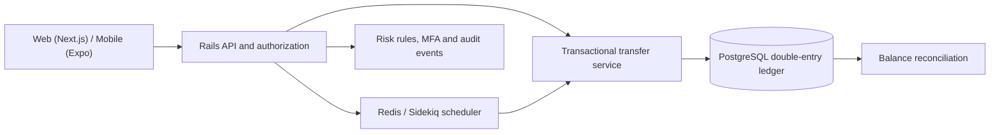

# Aurora — Financial Systems Engineering Case Study

**Portfolio case study | Ruby on Rails · PostgreSQL · Redis/Sidekiq · Next.js · React Native/Expo**

Aurora is a *fictional* digital banking simulator designed to test the engineering properties behind reliable financial transactions. It **does not handle real money, credit decisions, bank integrations or actual investments**.

## The engineering challenge

In a concurrent system, the interface may show a transfer as successful while the backend has only applied one side of the transaction. Network retries, terminated database sessions, simultaneous requests and delayed background jobs can produce duplicate or partially applied effects unless transaction boundaries are explicit.

Aurora therefore separates the user-facing experience from a server-authoritative accounting ledger.



## Key engineering choices

| Risk or requirement | Implemented approach |
| --- | --- |
| Partial debit/credit after failures | Atomic double-entry postings in PostgreSQL transactions, with rollback on interruption |
| Duplicate transfer after client retry | Idempotency keys and deterministic handling of already-committed operations |
| Concurrent withdrawals/transfers | PostgreSQL row locks in consistent order, plus constraints and transactional checks |
| Out-of-date sessions during a sensitive operation | Revalidation of session and MFA state inside the financial transaction boundary |
| Background execution and cancellation races | Scheduled work with persistent intent, transactional status and duplicate-job handling |
| Ledger/cache inconsistencies | Reconciliation and audit evidence; privileged corruption detected in a controlled test |
| API session abuse | HttpOnly/SameSite cookies, origin/CSRF validation, refresh rotation and admin MFA |

## Evidence, not just features

The [phase-8 validation record](phase-8-validation.md) documents a local verification with:

- **155 backend RSpec examples, zero failures** against Ruby 3.4.11, Rails 8.1.4 and PostgreSQL 17.
- A controlled connection kill **between debit and credit**, preserving rollback, balances and ledger consistency.
- Real scheduler/Sidekiq tests including a scheduled one-cent transfer; Redis interruption returned HTTP 503 rather than bypassing dependency checks.
- **7 web unit tests**, Next.js build/type checks, and **3 Playwright Chromium flows** using the real containerized API.
- **34 mobile tests** and successful TypeScript checks; Hermes Android/iOS bundles generated with test endpoints.

These counts describe **the recorded validation snapshot**, not a guarantee that every current branch and dependency combination passes. Use [GitHub Actions](../.github/workflows/ci.yml) and repeat the setup before relying on the results.

## Known limitations and security posture

- The application is educational. No real banking, payments, securities trading, scores or personal finance advice.
- The phase-8 report identifies **15 high-severity transitive npm audit alerts** in the mobile toolchain. Mobile distribution is blocked until vulnerabilities are resolved and revalidated; this is deliberately **not** presented as an all-green release.
- This project does not claim a publicly deployed service, app-store releases, physical-device security testing, independent audit, regulatory certification, or production suitability.
- Production operations would require a fresh threat model, backup/restore tests, privacy review, secrets management, distribution signing, monitoring and incident response.

## Reproduction path

Use Docker Desktop/Compose and follow the repository's [README](../README.md) and [Windows guide](guia-windows.md). With Docker installed:

```bash
cp .env.example .env
# Configure only test values; never commit secrets.
docker compose build
docker compose up -d
docker compose run --rm test
```

The actual setup scripts are `scripts/setup.sh` and `scripts/test.sh` (PowerShell counterparts are available). **Do not use personal documents, passwords, bank accounts or real funds as test inputs.**

## Skills illustrated

Transactional backend engineering · ACID data integrity · concurrency and fault injection · secure session design · API contracts · automated tests · web/mobile architecture · explicit failure reporting.

**Engineer:** Diogo Abreu da Silva — Electronic Engineering undergraduate, UNIFEI, Brazil.

**Further reading:** [Architecture and detailed report](relatorio-do-projeto.md) · [Validation](phase-8-validation.md) · [Security](security.md).
